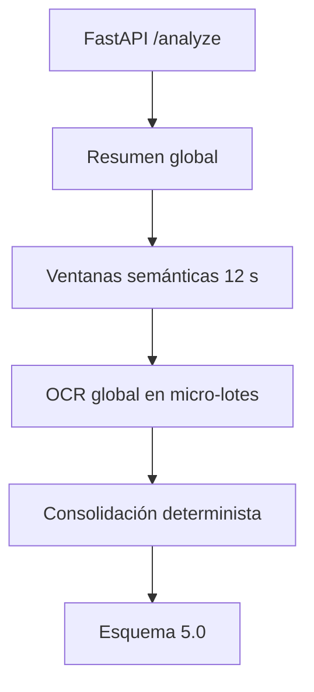

# Qwen3.5-4B Visual Analysis Service

Servicio local de FastAPI para extraer información visual de videos de redes
sociales con `Qwen/Qwen3.5-4B`. Está diseñado para Windows 11, una AMD Radeon
RX 9070 XT de 16 GiB, PyTorch ROCm y un único proceso residente.

Esta edición contiene una sola ruta de producto y una sola versión de prompt.
No conserva los prompts, esquemas ni endpoints experimentales de Qwen2.5.

## Arquitectura



- El modelo se carga una vez en BF16 y permanece en la GPU.
- Todas las inferencias se serializan con un `threading.Lock`.
- `enable_thinking=False` evita cadenas de razonamiento antes del JSON.
- SDPA es el backend de atención predeterminado por compatibilidad con ROCm.
- Los videos se segmentan sólo internamente; la respuesta semántica no contiene
  timestamps ni números de frame.
- El OCR muestrea el video completo una vez, sin repetir frames por el overlap de
  ventanas, y agrupa cuatro imágenes por inferencia.
- La recuperación de JSON truncado es estructural y determinista. Nunca existe
  una segunda llamada generativa de reparación.

## Preparación

1. Ejecuta PowerShell como usuario normal:

   ```powershell
   .\scripts\setup-env.ps1
   ```

2. Descarga el checkpoint:

   ```powershell
   .\scripts\download-model.ps1
   ```

3. Verifica ROCm:

   ```powershell
   .\scripts\verify-gpu.ps1
   ```

4. Ajusta, si hace falta:

   ```powershell
   $env:VISUAL_MEDIA_ROOT = "E:\personal-media-search\data\media"
   $env:VISUAL_QWEN_MODEL_ID = "E:\Trabajo\Proyectos\Qwen\Qwen3.5-4B"
   ```

5. Inicia el servicio:

   ```powershell
   .\scripts\start-service.ps1
   ```

La instalación usa Transformers 5.11 o posterior. Qwen3.5 requiere una versión
reciente que exponga `AutoModelForMultimodalLM` y contenga las correcciones de
entrada de video. El script no instala FlashAttention 2 ni kernels CUDA, porque
no son la ruta compatible con este entorno Windows/AMD.

## API

- `GET /health`
- `GET /ready`
- `GET /model`
- `POST /v1/visual-analysis/plan`
- `POST /v1/visual-analysis/analyze`

Ejemplo:

```json
{
  "runId": "run-001",
  "contentId": "video-001",
  "mediaPath": "E:/personal-media-search/data/media/video.mp4",
  "durationMs": 65000
}
```

## Pruebas y benchmark

```powershell
.\scripts\run-tests.ps1
.\.venv\Scripts\python.exe scripts\benchmark_e2e.py
```

El benchmark hace un calentamiento visual corto por defecto para que la
compilación diferida de la primera forma de tensores no contamine el primer
video medido. Usa `--no-warmup` para medir también ese costo.

Los valores de FPS, ventanas, resolución, lotes OCR y límites de salida son
configurables mediante variables `VISUAL_*`; los defaults son el punto inicial
optimizado para comparar contra `data/baselines/qwen25-v5.json`, no una regla
universal.
